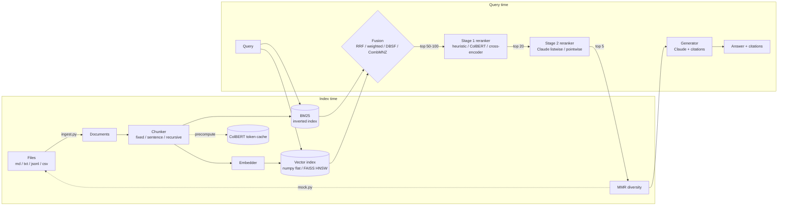

# Architecture

## Module map

| Module | Responsibility |
|---|---|
| `types.py` | `Document`, `SearchResult` (with per-stage `scores` and `ranks` history) |
| `text.py` | tokenizer (keeps identifiers intact), light stemmer, sentence splitter, char n-grams |
| `ingest.py` | `load_documents` / `ingest_path`: files -> `Document`s (front matter, metadata, error accounting) |
| `mock.py` | deterministic synthetic corpus + graded qrels + query kinds; BEIR / Markdown writers; `load_dataset` |
| `chunking.py` | `FixedSizeChunker`, `SentenceChunker`, `RecursiveChunker` - chunks keep `parent_id` |
| `embeddings.py` | `Embedder` protocol, `HashingEmbedder` (offline), `SentenceTransformerEmbedder`, `CachedEmbedder` |
| `retrievers/` | `BM25Retriever` (Okapi / BM25+ / BM25L), `DenseRetriever` (flat or FAISS), `HybridRetriever` |
| `fusion.py` | RRF, weighted, DBSF, CombSUM, CombMNZ + normalisers |
| `rerankers/` | heuristic, cross-encoder, ColBERT, LLM pointwise/listwise, MMR, HTTP (TEI), cascade, ensemble |
| `llm.py` | `LLMClient` protocol and `ClaudeClient` (structured outputs, refusal fallbacks, error mapping) |
| `generation.py` | `ClaudeGenerator` (native citations, streaming), `ExtractiveGenerator` (offline) |
| `pipeline.py` | `RAGPipeline`: index -> search -> rerank -> answer, with per-stage timings |
| `factory.py` | build any pipeline from YAML (`configs/`) |
| `evaluation/` | metrics (nDCG, MRR, recall, precision, MAP, hit rate), BEIR loader, evaluator, per-group breakdown, paired bootstrap |
| `api.py`, `cli.py` | FastAPI service and `hybrid-rag` CLI |

## Design decisions

* **Explainability by construction.** Every stage writes its score and rank into
  `SearchResult.scores` / `.ranks`, so you can always answer "why is this passage #1?"
  (`bm25#7 dense#1 rrf#2 cross_encoder#1`).
* **Small protocols, lazy heavy imports.** `Retriever`, `Reranker`, `Embedder`,
  `TokenEncoder`, `LLMClient` and `Generator` are tiny interfaces. Core install needs
  only numpy + PyYAML; torch and anthropic are imported only when a component that
  needs them is constructed.
* **Graceful degradation.** LLM rerankers fall back to first-stage order on failure;
  the pipeline still returns results.
* **Evaluation is a first-class citizen.** Chunk ids map back to parent documents in
  the evaluator, so chunking strategies are compared against document-level qrels.
* **Thread-safe rerankers.** Rerankers keep no per-query state, so one instance can
  serve concurrent API requests.
